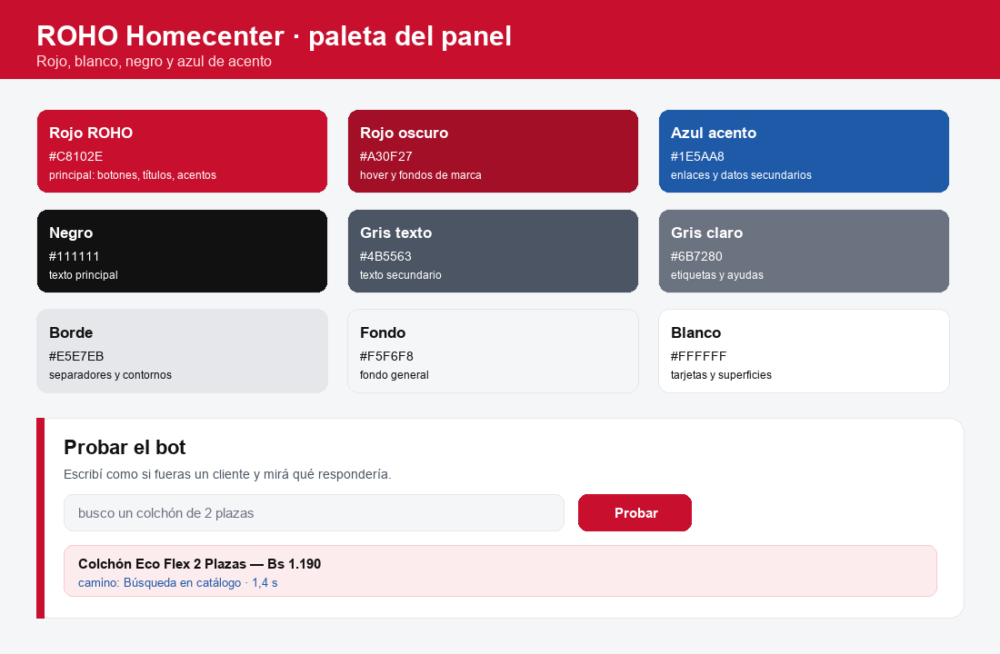

# Consola de asesores (React)

Frontend separado del API para la bandeja de handoffs y la administración de
agentes.

## Stack

- React 19
- Vite
- TypeScript
- Tailwind CSS 4
- React Router
- Componentes estilo shadcn/ui (`src/ui.tsx`)
- lucide-react para iconos

## Desarrollo

```powershell
cd admin-web
pnpm install
pnpm dev
```

Abre:

```text
http://127.0.0.1:5173
```

Vite hace proxy de `/advisor`, `/admin` y `/api` a:

```text
http://127.0.0.1:8000
```

Así la cookie de sesión funciona sin CORS.

## Build

```powershell
cd admin-web
pnpm build
```

Genera `admin-web/dist`.

Para servirla desde el API:

```powershell
pnpm build:console
```

Queda en:

```text
http://127.0.0.1:8000/console/
```

## Rutas

| Ruta | Función |
|---|---|
| `/login` | Ingreso de asesor |
| `/inbox` | Bandeja de handoffs |
| `/agents` | Administración de agentes (solo admin) |
| `/metrics` | Métricas de atención (admin/supervisor) |

## Funciones

- Login/logout con cookie.
- Bandeja con handoffs abiertos.
- Filtros: todos, pendientes, tomados, SLA.
- Búsqueda por nombre, número o motivo.
- Toasts y notificaciones del navegador.
- Badge de pendientes.
- Guardia visible.
- Detalle con conversación, carrito y pedidos.
- Tomar, responder y resolver.
- Composer con Enter para enviar, Shift+Enter para salto.
- Plantillas rápidas.
- Notas internas.
- Adjuntos salientes: imágenes y documentos.
- Adjuntos entrantes: previsualización de imágenes y descarga de documentos.
- Errores de envío visibles.
- Administración de agentes: crear, activar, guardia, admin.
- Tiempo real por SSE (`/advisor/events`), con respaldo cada 30 s.
- Estado leído/no leído por asesor.
- Filtros Todos, Pendientes, Míos, Sin asignar, SLA y Cerrados.
- Empty state con acción para limpiar filtros.
- Botón Volver en la conversación en móvil.
- Modo claro/oscuro persistido en `localStorage`.
- Atajo `Ctrl+K` para enfocar la búsqueda de la bandeja.
- Botón **Salir** visible en la barra superior.
- En móvil, al elegir un caso la consola hace scroll al panel de conversación.
- Navegación interna con `Link` para respetar `base=/console/`.

## Identidad visual

Paleta:

- rojo para acciones y alertas,
- azul para enlaces y estados secundarios,
- negro para cabecera y texto,
- blanco para superficies.

## Producción

Opciones:

1. Servir `dist/` con Nginx/Caddy y proxy `/advisor`, `/admin` y `/api` al API.
2. Servir desde el mismo dominio que FastAPI.
3. Mantener Vite solo para desarrollo.

No usar el dev server de Vite en producción.

## Paleta aplicada (rojo, blanco, negro y azul)

| Rol | Color |
| --- | --- |
| Rojo de marca (botones, títulos, acentos) | `#C8102E` |
| Rojo oscuro (hover, fondos de marca) | `#A30F27` |
| Azul de acento (enlaces, datos secundarios) | `#1E5AA8` |
| Negro (texto principal) | `#111111` |
| Grises de texto | `#4B5563` y `#6B7280` |
| Borde | `#E5E7EB` |
| Fondo general | `#F5F6F8` |
| Superficies | `#FFFFFF` |



Las clases usan valores hex directos (`bg-[#c8102e]`), así que un cambio de
paleta se hace con el mapa de `admin-web/src` y se reconstruye el bundle.
El modo oscuro tiene sus equivalencias en `admin-web/src/index.css`.