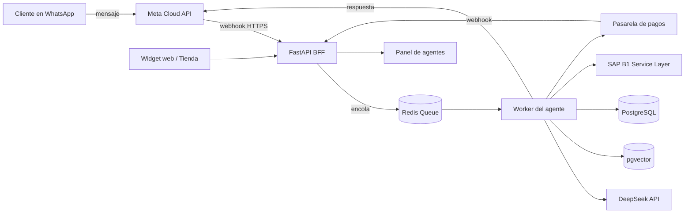
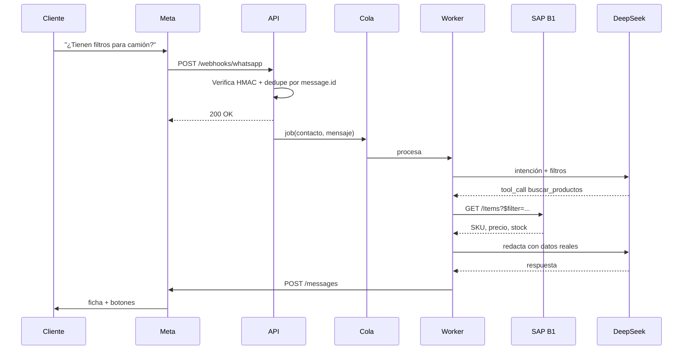
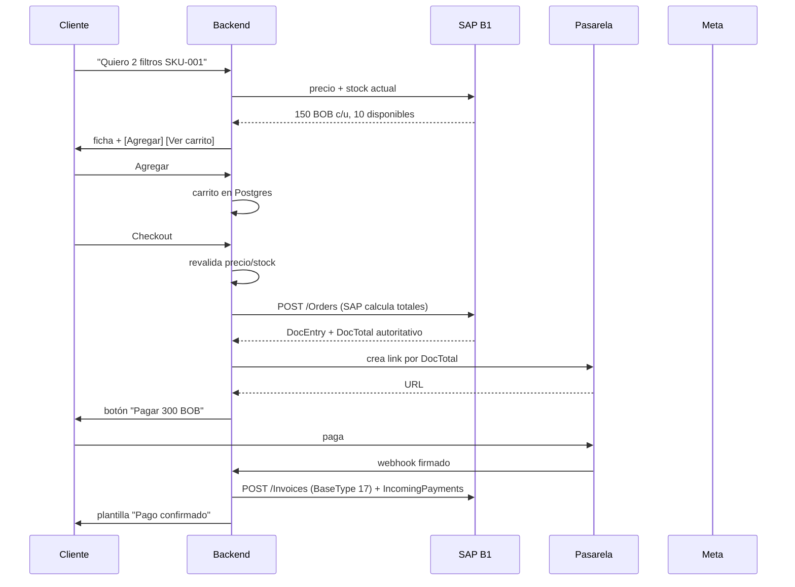

# Chatbot de WhatsApp + SAP Business One

**Arquitectura, decisiones técnicas y plan de implementación**
Versión 1.0 — 19 de octubre de 2026

---

## 0. Resumen ejecutivo

| Decisión | Recomendación |
|---|---|
| Canal | **WhatsApp Cloud API** (API oficial de Meta). La On-Premises está descontinuada y no se debe usar para proyectos nuevos. |
| Catálogo y carrito | **WhatsApp Flows** para la experiencia completa + catálogo nativo de Meta como complemento. El carrito nativo de WhatsApp existe, pero **no cobra**: sólo devuelve un mensaje de pedido. |
| Pagos | **Link de pago** (pasarela local / Stripe si la entidad lo permite) abierto desde el chat. WhatsApp Payments nativo sólo existe en India y Brasil; en Bolivia no está disponible. |
| IA | **DeepSeek** (modelo `deepseek-flash` o `deepseek-v4-pro`) para intención, diálogo y redacción. **Nunca** para calcular precios, stock, impuestos o totales. |
| Conocimiento | **Híbrido**: datos estructurados en vivo desde SAP B1 (Service Layer) + **RAG** sólo para texto no estructurado (descripciones, FAQs, políticas). |
| Backend | **Python 3.12 + FastAPI** (monolito modular), **PostgreSQL + pgvector**, **Redis**, worker con **LangGraph**. |
| Integración SAP | **Service Layer** (OData REST). No DI API para producción web; no escritura directa a la base de datos. |
| Multichannel | El core es **agnóstico del canal**: WhatsApp es un adaptador; se puede sumar widget web y tienda sin reescribir el cerebro. |
| Costo dominante | **No es la IA, es WhatsApp.** Desde el 1-oct-2026 cada respuesta de servicio (bot o humano) dentro de la ventana de 24 h se factura. Los mensajes entrantes siguen gratis. |

**Lo que cambia el diseño:** un chatbot conversacional que responde en 8 turnos puede costar más en mensajes de WhatsApp que en tokens de DeepSeek. Hay que diseñar conversaciones **cortas, consolidadas y con mensajes interactivos**, no un "echo bot" charlatán.

---

## 1. Qué puede y qué no puede WhatsApp (leer antes de diseñar)

### 1.1 Las tres vías de la API oficial

| Vía | Estado | Cuándo usarla |
|---|---|---|
| **Cloud API** (Meta aloja) | Recomendada y vigente | Proyecto nuevo, escalable, sin infraestructura de mensajería propia. |
| **On-Premises API** | Descontinuada / legacy | No usar en proyectos nuevos. |
| **App WhatsApp Business** (la del celular) | Otro producto, no es API | Sólo operación manual. No automatiza ni integra SAP. |

La Cloud API se consume por HTTPS contra Graph API (`POST /{phone-number-id}/messages`) y notifica por **webhooks**. No hay streaming: la respuesta se envía como mensaje completo (o varios), y el cliente ve "escribiendo…" sólo si se implementa el indicador correspondiente.

### 1.2 Catálogo nativo: existe, pero es limitado

Meta permite conectar un **catálogo de Commerce Manager** a la WABA y enviar mensajes de producto. El usuario puede abrir el catálogo, ver fichas y **agregar al carrito**. Cuando confirma, WhatsApp envía a tu webhook un mensaje `type: "order"`:

```json
{
  "type": "order",
  "order": {
    "catalog_id": "1234567890",
    "text": "Quiero estos",
    "product_items": [
      { "product_retailer_id": "SKU-001", "quantity": 2, "item_price": 150.0, "currency": "BOB" }
    ]
  }
}
```

Ese mensaje **no es un pago ni una orden de SAP**. Es una intención de compra que tu backend debe validar (precio, stock, cliente), convertir en pedido y cobrar por fuera.

Limitaciones prácticas:

- No hay pago nativo (salvo India/Brasil).
- No hay variantes reales (color/talla) salvo que modeles cada variante como SKU.
- El carrito nativo no pide dirección, método de envío ni cupón.
- El catálogo debe cumplir políticas de comercio y pasar revisión.
- La UX es rígida: no puedes mostrar disponibilidad por almacén ni precios por lista de cliente.
- El `item_price` que llega en el mensaje **no es confiable** para cobrar: se revalida siempre en el backend/SAP.

**Conclusión:** el catálogo nativo sirve para un MVP rápido y para "compartir producto", pero no para un checkout serio.

### 1.3 WhatsApp Flows: la pieza que sí permite catálogo + carrito

**Flows** son pantallas nativas dentro de WhatsApp, definidas en JSON, con formularios, listas, imágenes, selección de variantes y navegación entre pantallas. Se envían como mensaje interactivo:

```json
{
  "type": "interactive",
  "interactive": {
    "type": "flow",
    "action": {
      "name": "flow",
      "parameters": {
        "flow_message_version": "3",
        "flow_token": "checkout-<uuid>",
        "flow_id": "<FLOW_ID>",
        "flow_cta": "Ver catálogo",
        "flow_action": "navigate",
        "flow_action_payload": { "screen": "CATALOGO", "data": { "categoria": "filtros" } }
      }
    }
  }
}
```

Con un endpoint de **data exchange** (HTTPS, payload cifrado con RSA/AES y health check) puedes:

- listar productos con imagen y precio en vivo,
- filtrar por categoría,
- elegir variantes y cantidad,
- armar el carrito,
- pedir dirección y método de envío,
- mostrar resumen y totales,
- cerrar con un botón que abre el **link de pago** en el navegador interno.

Flows no permite incrustar HTML libre ni un formulario de tarjeta: por eso el pago se resuelve con link/redirect o, donde exista, con el componente de pago nativo.

**Costo de ingeniería:** alto comparado con texto (JSON del Flow, endpoint cifrado, versionado, pruebas en dispositivo). Por eso se hace en fase 3, no en la primera semana.

| Enfoque | Esfuerzo | Experiencia | Pago | Cuándo usarlo |
|---|---|---|---|---|
| Catálogo nativo | Bajo | Rígida, familiar | Fuera del chat | MVP y "compartir producto" |
| WhatsApp Flows | Alto | Nativa y personalizada | Link/redirect | Carrito y checkout reales |
| Tienda web enlazada | Medio | Completa, SEO | Pasarela web | Catálogo grande o B2B |

### 1.4 Pagos: la verdad incómoda

**WhatsApp Payments for Business** (pago dentro del chat) está disponible sólo en **India** (UPI, gateways, links) y **Brasil** (Pix, boleto, net banking). En el resto de países, incluida Bolivia, **no existe**.

Entonces, para tu caso:

1. El bot arma el pedido y calcula el total **en el backend/SAP**.
2. Genera un **link/QR de pago** con una pasarela. En Bolivia, **CUCU / QR Simple** ya expone una API sandbox (`POST /qr`, webhook `qr.paid` firmado): es la opción integrada en el scaffold. Libélula, Stripe/PayPal/Mercado Pago quedan como alternativas según la entidad.
3. Envía el link con un botón CTA (`cta_url`) o desde la pantalla final del Flow.
4. La pasarela confirma por **webhook firmado**; el backend marca el pago, crea la factura y el pago en SAP, y notifica al cliente.
5. Un job de reconciliación cierra pagos huérfanos, expira links y cancela pedidos abandonados.

Reglas de oro:

- **Nunca** pidas número de tarjeta, CVV ni datos bancarios por chat.
- **Nunca** confíes en el monto que envía el cliente o el LLM: se recalcula en servidor.
- Verifica firma del webhook, monto, moneda y referencia antes de dar por pagado.
- Un pago puede llegar dos veces: **idempotencia obligatoria**.

### 1.5 Ventana de 24 horas, plantillas y calidad

- Cuando el usuario escribe, se abre una **ventana de servicio de 24 h**. Dentro de ella puedes responder con texto libre (y, desde el 1-oct-2026, **cada respuesta se factura**, a la tarifa de utility/authentication del mercado y **sin descuento por volumen**).
- Fuera de la ventana sólo puedes iniciar con **plantillas aprobadas** (utility para confirmaciones y estados de pedido, marketing para promociones).
- Las plantillas se aprueban por categoría e idioma; una plantilla rechazada se puede apelar.
- Los **mensajes entrantes son gratis**. Los **entry points** (anuncios click-to-WhatsApp, QR) tienen ventanas promocionales; conviene aprovecharlos.
- La WABA tiene **límite de mensajería** (250 → 1.000 → 10.000 → 100.000 → ilimitado) según verificación, volumen y **quality rating**. Un bot que envía mucho y recibe bloqueos baja de nivel.
- El **display name** pasa revisión; debe corresponder al negocio.
- La **verificación de negocio** de Meta es un requisito práctico para escalar y para muchas funciones.

### 1.6 ¿Sólo funciona en la app de WhatsApp o también desde web?

**WhatsApp es un canal, no la arquitectura.** El mismo core puede atender:

| Canal | Cómo | Reutilización |
|---|---|---|
| WhatsApp | Cloud API + webhooks | Adaptador `WhatsAppAdapter` |
| Web (widget de chat) | WebSocket/SSE contra el mismo orquestador | Adaptador `WebAdapter` |
| Tienda web | Next.js + checkout propio | Mismos servicios de catálogo/carrito/pedido |
| Instagram/Facebook Messenger | Misma app de Meta, otro webhook | Adaptador adicional |

Lo que **no** se puede es "incrustar WhatsApp" dentro de una web: los mensajes viven en los clientes de WhatsApp (móvil, escritorio, web.whatsapp.com). Un botón `wa.me` es sólo un enlace de inicio de chat, no una integración.

La decisión correcta es **core multicanal + adaptadores**. Si hoy sólo se necesita WhatsApp, se implementa un solo adaptador, pero sin acoplar la lógica de negocio al formato de Meta.

---

## 2. Checklist de configuración previa

Nada de esto se resuelve escribiendo código; y algunos trámites tardan días o semanas. Empieza por aquí.

### 2.1 Meta / WhatsApp

- [ ] **Portfolio de negocio** en Meta Business Suite, con datos legales consistentes.
- [ ] **Verificación de negocio** (documento legal, identificación fiscal, web/dominio, factura de servicios). Sin esto, los límites y funciones quedan recortados.
- [ ] **WABA** (WhatsApp Business Account) creada y vinculada al portfolio.
- [ ] **Número dedicado**: capaz de recibir SMS o llamada de verificación, **no** registrado en WhatsApp Consumer, que no sea short code ni número de tarificación especial. Si el número ya está en la app WhatsApp Business, hay que migrarlo/eliminarlo o evaluar **coexistencia**.
- [ ] **Display name** que cumpla las políticas (nombre comercial real; evita "Soporte", "Ventas", genéricos).
- [ ] **App en developers.facebook.com** tipo Business, producto WhatsApp agregado, WABA vinculada.
- [ ] **Identificadores**: App ID, App Secret, Phone Number ID, WABA ID, Business Portfolio ID.
- [ ] **Usuario del sistema** (system user) con rol de administrador y **token permanente** con permisos `whatsapp_business_messaging`, `whatsapp_business_management` y `business_management`. Guardar en un secret manager, no en el repositorio.
- [ ] **App Review / acceso avanzado** a los permisos de WhatsApp, política de privacidad publicada, callback de eliminación de datos, app en modo Live. Si sólo operas tu propia WABA puede que no lo necesites al inicio, pero para producción y para terceros sí.
- [ ] **Webhook HTTPS** con certificado válido (no autofirmado), `verify_token` propio y suscripción al campo `messages` (más `message_template_status_update`, `account_update`, `phone_number_quality_update`).
- [ ] **Método de pago** de la WABA cargado (tarjeta) y moneda de facturación configurada.
- [ ] **PIN de verificación en dos pasos** del número, guardado de forma segura (se pide al registrar).
- [ ] **Plantillas** creadas y aprobadas: confirmación de pedido, link de pago, pago confirmado, envío, cancelación, recuperación de carrito. En español (y los idiomas que uses).
- [ ] **Opt-in** documentado (el usuario inicia el chat o acepta un checkbox en la web). Meta exige consentimiento para mensajes iniciados por el negocio.
- [ ] **Catálogo** en Commerce Manager con feed (CSV/XML/API), políticas de comercio, envíos y moneda; conectado a la WABA.
- [ ] **Flows** creados, publicados y probados con el número de prueba (Meta da un número de test con hasta 5 destinatarios).
- [ ] **Quality rating y límites** monitoreados desde el día uno.

> **Sobre coexistencia:** Meta permite usar el mismo número en la app WhatsApp Business y en la Cloud API (con limitaciones). Sirve si el equipo comercial necesita atender manualmente desde el celular. Confirma que tu caso y tu proveedor la soportan antes de diseñar alrededor de ella.

### 2.2 SAP Business One

- [ ] **Versión de B1** y base de datos (HANA / SQL Server), si es on-premise o alojado por un partner.
- [ ] **Service Layer habilitado** y accesible por HTTPS en `https://<host>:50000/b1s/v1/`, con certificado válido (o cadena corporativa instalada en el cliente).
- [ ] **Usuario de integración** dedicado, con licencia, permisos mínimos (Items, BusinessPartners, Orders, Invoices, IncomingPayments, PriceLists, Warehouses) y **sin** privilegios de administrador.
- [ ] **Base de datos de la empresa** (CompanyDB) y ambiente de pruebas separado. No se prueba en producción.
- [ ] **Series y numeración** para pedidos/facturas del canal WhatsApp, con prefijo identificable.
- [ ] **Campos definidos por el usuario (UDF)**: `U_WA_ID` (teléfono E.164), `U_Canal` = `WA`, `U_WAOrderID`, `U_ImgURL` (imagen del artículo), `U_DescripcionWeb` si falta descripción comercial.
- [ ] **Calidad del maestro de artículos**: nombre comercial, descripción, marca, categoría, código de barras, unidad, impuestos, imagen. Sin esto, ningún RAG ni LLM arregla el catálogo.
- [ ] **Variantes**: B1 no tiene matriz de variantes nativa; cada variante debe ser un `ItemCode` propio (o modelarse con UDF y reglas). Decidirlo antes de cargar el catálogo.
- [ ] **Almacenes** y stock por almacén (`ItemWarehouseInfoCollection`), además de stock comprometido/disponible.
- [ ] **Listas de precio** y reglas de descuento por cliente/volumen; definir qué precio ve un cliente no identificado.
- [ ] **Socios de negocio**: estrategia de alta automática por teléfono, deduplicación, grupo/segmento, condición de pago y límite de crédito.
- [ ] **Métodos de pago y cuentas de mayor** para registrar cobros (`IncomingPayments`), además de la pasarela.
- [ ] **Procedimientos de aprobación** de pedidos: si B1 exige aprobación, el pedido creado por el bot puede quedar bloqueado. Definir si se usa un usuario autorizado o un flujo de aprobación.
- [ ] **Conectividad**: si B1 es on-premise, el backend debe vivir en la misma red o conectarse por VPN/túnel. **No exponer el puerto 50000 a Internet.**

### 2.3 Pagos

- [ ] País de la entidad legal y moneda.
- [ ] Pasarela disponible en ese país (Bolivia: Libélula, QR Simple, transferencia; otros: Stripe, PayPal, Mercado Pago).
- [ ] Cuenta de comercio aprobada, credenciales de sandbox y producción.
- [ ] Webhooks de pago firmados, con reintentos e idempotencia.
- [ ] Política de reembolsos, cancelaciones y contracargos.
- [ ] Definición contable: ¿se cobra antes del pedido (prepago) o contra factura? ¿Se emite factura al pagar o al despachar?
- [ ] Impuestos y datos fiscales del cliente (NIT/CI) si la factura los requiere.

### 2.4 Infraestructura

- [ ] Dominio y subdominio para webhooks (`https://api.tudominio.com`).
- [ ] Certificado TLS válido y renovación automática.
- [ ] Servidor/cloud: 2 vCPU / 4 GB para MVP; PostgreSQL gestionado; Redis.
- [ ] Secret manager (o al menos variables de entorno cifradas) para tokens de Meta, SAP, DeepSeek y pasarela.
- [ ] Backups de base de datos y plan de retención de conversaciones.
- [ ] Observabilidad mínima: logs estructurados, trazas, alertas de errores 5xx y de webhooks fallidos.
- [ ] Para desarrollo: túnel (Cloudflare Tunnel / ngrok) porque Meta exige HTTPS público.

---

## 3. Arquitectura propuesta

### 3.1 Vista general



**Principio:** el webhook sólo valida, deduplica y encola; responde `200` en milisegundos. Todo el trabajo pesado (LLM, SAP, pagos) ocurre en workers. Si el webhook tarda, Meta reintenta y duplica mensajes.

### 3.2 Flujo de un mensaje



Detalles que evitan dolores:

- **Deduplicación** por `messages[].id` en una tabla única; Meta reintenta.
- **Orden por contacto**: una sola conversación procesada a la vez (lock en Redis por `wa_id`), para que dos respuestas no se crucen.
- **Idempotencia** en toda escritura a SAP y en la creación de links de pago.
- **Timeout** del LLM y de SAP con fallback ("estoy consultando, te confirmo en un momento" — pero cuidado: cada mensaje cuesta).
- **Marcar como leído** y, si se usa, indicador de "escribiendo".

### 3.3 Flujo de compra



Puntos críticos:

1. **El carrito vive en Postgres**, no en el LLM ni en la sesión de WhatsApp.
2. **El pedido en SAP es la fuente de verdad del total.** Se crea antes de cobrar y se lee `DocTotal`; el link de pago usa ese monto.
3. Si el pago falla o expira, se **cancela el pedido** (o se deja abierto con job de limpieza) y se libera stock.
4. La factura se crea **sólo después** del pago confirmado, salvo que el negocio facture contra pedido.
5. Cada transición tiene estado explícito: `draft → pending_payment → paid → invoiced → shipped → cancelled`.

### 3.4 Módulos (monolito modular)

| Módulo | Responsabilidad |
|---|---|
| `channels/whatsapp` | Parseo de webhooks, envío de mensajes, plantillas, media, Flows. |
| `channels/web` | WebSocket/SSE para el widget. |
| `conversation` | Estado, historial, resumen, locks, handoff. |
| `agent` | LangGraph: router, tools, composición, guardrails. |
| `catalog` | Búsqueda híbrida, fichas, imágenes, sinónimos. |
| `cart` | Carrito, validaciones, cupones. |
| `orders` | Creación y seguimiento de pedidos en SAP. |
| `payments` | Links, webhooks, conciliación, reembolsos. |
| `sap` | Cliente Service Layer, reintentos, mapeo, caché. |
| `admin` | API para panel, agentes, catálogo, métricas. |
| `notifications` | Plantillas, envíos proactivos, opt-out. |

Se puede empezar como un solo servicio FastAPI con carpetas separadas; separar en servicios sólo cuando haya una razón medida (equipos, carga, despliegues).

---

## 4. Stack recomendado

### 4.1 Opción A — Python (recomendada)

| Capa | Tecnología | Por qué |
|---|---|---|
| Lenguaje | Python 3.12 | Ecosistema AI/RAG, rapidez de desarrollo, equipo fácil de encontrar. |
| API | FastAPI + Pydantic v2 | Async, OpenAPI, validación, buen rendimiento. |
| Orquestación LLM | **LangGraph** | Estado explícito, tools, interrupciones para handoff, checkpoints; proveedor-agnóstico. |
| LLM | **DeepSeek** (`deepseek-flash` / `deepseek-v4-pro`) | Precio muy bajo, tool calling, contexto 1M, API compatible con OpenAI. |
| Embeddings | **BGE-M3** self-host o OpenAI/Cohere | DeepSeek **no** ofrece endpoint de embeddings; hay que usar otro proveedor. |
| Base de datos | PostgreSQL 16 + **pgvector** | Una sola base para transaccional + vectores + full-text. |
| Cola | Redis + **Arq** (o Celery) | Simple, async, reintentos, programación. |
| Caché/locks | Redis | Dedupe, locks por contacto, caché de stock/precio. |
| SAP | **Service Layer** vía `httpx` | REST/OData, multiplataforma; sin COM. |
| Panel | Next.js + React + Tailwind | Inbox de agentes, catálogo, métricas. |
| Observabilidad LLM | **Langfuse** (self-host) | Trazas, prompts versionados, costo por conversación, evals. |
| Infra | Docker Compose (dev) → VPS/K8s (prod) | Portable; puede correr on-premise junto a SAP. |

### 4.2 Opción B — TypeScript

| Capa | Tecnología |
|---|---|
| API | NestJS + Zod |
| Orquestación | LangGraph.js |
| ORM | Prisma |
| Cola | BullMQ |
| Frontend | Next.js |
| Ventaja | Un solo lenguaje en todo el stack. |
| Desventaja | Menos madurez en RAG/ML y menos librerías de evaluación. |

**Recomendación:** A para el cerebro y los datos; TypeScript sólo en el panel. Si el equipo es 100% JS, B es viable, pero el costo de iteración en RAG será mayor.

### 4.3 Lo que NO recomiendo

- **n8n / Make como núcleo**: sirven para prototipos, pero el estado de carrito, la idempotencia y los reintentos con SAP se vuelven frágiles.
- **DI API / COM**: sólo Windows, no escala para web, requiere sesión por proceso.
- **Escritura directa a SQL/HANA**: salta validaciones, numeraciones, impuestos y auditoría de SAP.
- **Meter todo el catálogo en el prompt**: caro, lento y propenso a inventar; usa herramientas y retrieval.
- **Un LLM que "decida" precios o stock**: alucina. Los datos siempre vienen de SAP.

---

## 5. Integración con SAP Business One

### 5.1 Por qué Service Layer

- Es la API REST/OData oficial de B1, disponible en versiones modernas.
- Funciona desde Linux/contenedores, a diferencia de DI API (COM/Windows).
- Respeta validaciones, numeraciones, impuestos y permisos de SAP.
- Permite leer y escribir: artículos, socios, pedidos, facturas, cobros.

Requisitos: Service Layer habilitado, HTTPS, usuario con licencia y permisos, conectividad de red.

### 5.2 Autenticación y sesión

```http
POST https://sap-host:50000/b1s/v1/Login
Content-Type: application/json

{ "CompanyDB": "MI_EMPRESA", "UserName": "integracion_wa", "Password": "***" }
```

Devuelve cookies `B1SESSION` y `ROUTEID`. La sesión expira alrededor de **30 minutos**; ante un `401` hay que volver a hacer login. Si hay balanceador, `ROUTEID` es obligatorio para mantener afinidad.

```python
import httpx

class ServiceLayer:
    def __init__(self, base_url: str, company_db: str, user: str, password: str):
        self.base = base_url.rstrip("/")
        self.creds = {"CompanyDB": company_db, "UserName": user, "Password": password}
        self.client = httpx.AsyncClient(base_url=self.base, timeout=20.0)

    async def login(self) -> None:
        r = await self.client.post("/Login", json=self.creds)
        r.raise_for_status()
        # httpx conserva B1SESSION y ROUTEID en el cookie jar

    async def request(self, method: str, path: str, **kwargs):
        if not self.client.cookies:
            await self.login()
        r = await self.client.request(method, path, **kwargs)
        if r.status_code == 401:
            await self.login()
            r = await self.client.request(method, path, **kwargs)
        r.raise_for_status()
        return r
```

Buenas prácticas:

- Un solo cliente por proceso, con lock para evitar logins concurrentes.
- Reintentos con backoff sólo en `429`, `502`, `503`, `504`; **nunca** reintentar un `POST` sin idempotencia.
- Circuit breaker: si SAP falla, responder al usuario con un mensaje honesto y escalar; no dejar el bot colgado.
- Métricas: latencia por endpoint, tasa de 401, errores de validación.

### 5.3 Lectura: catálogo, precios y stock

| Dato | Endpoint / entidad | Notas |
|---|---|---|
| Artículos | `GET /Items` | `$select`, `$filter`, `$top`, `$skip`; paginación obligatoria. |
| Stock por almacén | `ItemWarehouseInfoCollection` dentro de `Items` | `InStock`, `Committed`, `Ordered`, `Available` según versión. |
| Precios | `ItemPrices` / listas de precio | La lógica de precio de B1 es compleja (lista del socio, descuentos, UoM). |
| Socios | `GET/POST /BusinessPartners` | Buscar por teléfono antes de crear. |
| Almacenes | `GET /Warehouses` | Códigos y nombres para el checkout. |
| Impuestos | `GET /VatGroups` / configuración | No calcular impuestos a mano. |
| Pedidos | `GET /Orders` | Seguimiento por `DocEntry`/`DocNum` y UDF. |

Estrategia recomendada:

1. **Sincronización nocturna** de artículos, descripciones, categorías, imágenes y precios a Postgres (tabla `catalog_items`). Es lo que alimenta búsqueda y RAG.
2. **Refresco incremental** cada 5–15 minutos si la versión expone fecha de modificación; si no, full sync nocturno y refresco por SKU consultado.
3. **Stock en vivo** al mostrar ficha y **revalidación obligatoria** al crear el pedido.
4. **Precio autoritativo**: se lee de SAP; el LLM nunca lo inventa. Si hay descuentos, se aplican en SAP, no en el prompt.

### 5.4 Escritura: pedido, factura y pago

**Crear pedido** (dejar que SAP calcule precio, impuesto y total):

```http
POST /b1s/v1/Orders
{
  "CardCode": "CWA000123",
  "DocDate": "2026-10-19",
  "DocDueDate": "2026-10-26",
  "Comments": "Pedido WhatsApp",
  "U_Canal": "WA",
  "U_WAOrderID": "wa-7f3c...",
  "DocumentLines": [
    { "ItemCode": "FILT-001", "Quantity": 2, "WarehouseCode": "01" }
  ]
}
```

La respuesta trae `DocEntry`, `DocNum`, `DocTotal`, `VatSum`. **Ese** `DocTotal` es el que se cobra.

**Facturar desde el pedido** (referencia de línea base):

```http
POST /b1s/v1/Invoices
{
  "CardCode": "CWA000123",
  "DocumentLines": [
    { "BaseType": 17, "BaseEntry": 1234, "BaseLine": 0, "Quantity": 2 }
  ]
}
```

`BaseType: 17` corresponde a Sales Order. Verifica el mapeo de líneas y cantidades parciales en tu versión.

**Registrar el cobro**:

```http
POST /b1s/v1/IncomingPayments
{
  "CardCode": "CWA000123",
  "DocDate": "2026-10-19",
  "PaymentInvoices": [
    { "DocEntry": 5678, "SumApplied": 300.00 }
  ]
}
```

Ajusta `CashAccount`, `PaymentMethod` y `TransferAccount` a la configuración contable real. Si la pasarela retiene comisión, el asiento puede requerir una línea de gasto/ajuste.

**Idempotencia:** antes de crear, buscar por `U_WAOrderID` (`GET /Orders?$filter=U_WAOrderID eq '...'`). Si ya existe, devolver el existente. Lo mismo para pagos: una tabla `payment_events` con el ID del evento de la pasarela como unique.

### 5.5 Sincronización y caché

| Dato | Freshness | Estrategia |
|---|---|---|
| Descripciones, categorías, imágenes | Horas | Sync nocturno + edición en panel. |
| Precio de lista | Minutos | Caché 60 s + refresco por SKU. |
| Stock | Segundos/minutos | Consulta en vivo o caché 30–60 s. |
| Pedido/pago | Tiempo real | Siempre SAP. |

**Nunca** cachear el resultado de una creación de pedido como si fuera una lectura: son operaciones distintas.

### 5.6 Mapeo de datos

| WhatsApp / backend | SAP B1 | Regla |
|---|---|---|
| `wa_id` (E.164) | `BusinessPartners.Phone1` + UDF `U_WA_ID` | Normalizar; deduplicar antes de crear. |
| Nombre de perfil | `CardName` | Es un dato débil; pedir confirmación para facturación. |
| Carrito | `Orders` (no hay carrito en SAP) | El carrito vive en Postgres. |
| Pedido | `Orders` | `U_Canal = WA`, `U_WAOrderID`. |
| Pago | `IncomingPayments` | Referencia a factura. |
| Factura | `Invoices` | Datos fiscales del cliente. |
| Producto | `Items` | Un SKU por variante. |

**Alta de socio:** crear con grupo/segmento "WhatsApp", condición de pago contado por defecto, y un UDF para el canal. Si el cliente ya existe por teléfono, reutilizarlo. Para B2B, validar NIT y límite de crédito antes de vender a crédito.

### 5.7 Errores y concurrencia

- **Doble submit** del usuario: lock por carrito + idempotency key.
- **Stock insuficiente** al crear: SAP rechaza; el bot ofrece alternativas o reduce cantidad.
- **Precio cambió** entre ficha y checkout: se muestra el nuevo total antes de pagar; nunca cobrar el viejo.
- **Pedido creado y pago no llega**: job de reconciliación a los 15/60 minutos; cancelar y liberar.
- **SAP caído**: modo degradado (sólo consultas cacheadas) y handoff humano; no prometer compra.
- **Aprobaciones de SAP**: si el pedido queda pendiente, informar estado "en revisión" en lugar de "confirmado".

### 5.8 Red y despliegue on-premise

Si SAP B1 está en la empresa:

- El backend (o al menos el conector) vive en la misma red que el Service Layer.
- El webhook de Meta entra por un reverse proxy público (Caddy/Nginx/Cloudflare Tunnel) a la API interna.
- **No** se publica el puerto 50000; se usa VPN/túnel o allowlist de IP.
- Si el backend va a la nube, se necesita un túnel saliente (WireGuard/Tailscale/Cloudflare Tunnel) hacia SAP; el tráfico de SAP no sale a Internet.
- Para desarrollo, un túnel temporal sirve, pero el webhook de producción debe ser estable y con TLS válido.

---

## 6. IA: agente + RAG

### 6.1 Qué hace el LLM y qué no

| El LLM sí | El LLM no |
|---|---|
| Entender lenguaje natural y sinónimos | Calcular precios, impuestos o totales |
| Decidir qué herramienta llamar | Inventar stock o fechas de entrega |
| Redactar respuestas claras | Crear pedidos sin confirmación |
| Pedir aclaraciones | Aplicar descuentos no autorizados |
| Resumir la conversación | Sustituir validaciones de SAP |

**Regla:** el LLM propone; el backend valida; SAP manda.

### 6.2 Herramientas (function calling)

Definir un conjunto pequeño y tipado:

```text
buscar_productos(query, categoria?, precio_max?, atributos?)
obtener_producto(sku)
consultar_disponibilidad(sku, cantidad, almacen?)
consultar_precio(sku, cantidad)
agregar_al_carrito(sku, cantidad, variante?)
ver_carrito()
actualizar_cantidad(sku, cantidad)
vaciar_carrito()
cotizar_envio(ciudad, metodo?)
crear_pedido(datos_fiscales?)
generar_link_pago(pedido_id)
consultar_pedido(numero_o_id)
escalar_a_humano(motivo)
```

Cada herramienta: validación de argumentos, timeout, reintentos limitados, logging y respuesta estructurada. El LLM nunca recibe SQL ni credenciales.

### 6.3 RAG: qué indexar y qué no

**No indexar como fuente de verdad:** precios, stock, estado de pedidos, saldos. Eso se consulta en vivo.

**Indexar:**

- Descripciones comerciales y atributos de producto (texto enriquecido, no sólo el nombre de SAP).
- Sinónimos y jerga local ("filtro de aceite" vs "filtro aceite", marcas, medidas).
- FAQs, políticas de envío, garantía, devoluciones, horarios.
- Guías de uso y compatibilidades.
- Promociones vigentes (con fecha de validez y validación final en backend).

**Diseño híbrido:**

1. El LLM extrae filtros estructurados (categoría, rango de precio, uso, medida).
2. Búsqueda en Postgres: full-text en español + `pgvector` + filtros SQL.
3. Fusión de rankings (RRF) y reranking (BGE-reranker o Cohere).
4. Hidratación: los IDs recuperados se consultan en SAP/caché para precio y stock.
5. El LLM redacta **sólo con los datos hidratados**; un validador comprueba que cada SKU y precio existan.

**Chunking:** un producto = un chunk (nombre + marca + categoría + atributos + descripción + sinónimos). FAQs: 300–500 tokens con solape. No partir una ficha en pedazos que pierdan el SKU.

### 6.4 Embeddings

DeepSeek no ofrece endpoint de embeddings. Opciones:

| Opción | Ventaja | Costo |
|---|---|---|
| **BGE-M3** self-host | Multilingüe, sin costo por token, control de datos | Infra GPU/CPU; latencia. |
| OpenAI `text-embedding-3-small/large` | Calidad y simplicidad | Pago por token; datos fuera. |
| Cohere `embed-multilingual-v3` | Buen multilingüe | Pago por token. |

Para español y vocabulario técnico, BGE-M3 o un modelo multilingüe es buena base. Dimensión típica 1024; usa índice HNSW en pgvector.

**Cuándo NO hace falta RAG:** si el catálogo es pequeño (<2.000 SKUs) y las descripciones son buenas, búsqueda SQL + full-text + sinónimos puede bastar. El RAG se justifica cuando hay variabilidad de lenguaje, catálogo grande o documentación extensa.

### 6.5 Agente, estado y guardrails

- **Router de intención** antes del LLM grande: saludo, catálogo, pedido, pago, postventa, humano. Ahorra tokens y latencia.
- **FSM para el checkout**: los pasos críticos (dirección, confirmación, pago) son deterministas; el LLM sólo interpreta y redacta.
- **Confirmación explícita** antes de crear pedido: "Voy a generar un pedido por 2 filtros, total 300 BOB, ¿confirmas?".
- **Límites**: máximo de turnos por conversación, máximo de mensajes por minuto, tamaño de entrada.
- **Anti prompt injection**: el texto del usuario es dato, no instrucción; las herramientas tienen allowlist; no hay herramientas que ejecuten SQL libre.
- **Privacidad**: no repetir datos sensibles innecesarios; enmascarar teléfonos/correos en logs.
- **Handoff**: si el usuario pide humano, hay baja confianza repetida, reclamo o tema legal → pausar bot, notificar agente, mantener contexto.

### 6.6 Evaluación

Antes de producción, un set de 100–200 conversaciones reales o sintéticas con:

- intención correcta,
- herramienta correcta y argumentos válidos,
- cero precios/stock inventados,
- respuesta en español natural,
- escalado correcto.

Medir: precisión de tool calls, tasa de alucinación, contención (resuelto sin humano), tiempo de respuesta y costo por conversación. Correr la evaluación en cada cambio de prompt/modelo (Langfuse o un script propio).

### 6.7 Multimodalidad (lo que la gente realmente envía)

En WhatsApp la gente manda audios, fotos, ubicaciones y PDFs. Si el bot sólo entiende texto, la experiencia se rompe rápido.

| Entrada | Tratamiento | Nota |
|---|---|---|
| **Audio / nota de voz** | Transcripción con Whisper (self-host o API) antes del agente | Guardar transcripción, no el audio, salvo necesidad. |
| **Foto de producto o código** | Visión (DeepSeek Flash soporta visión) u OCR | Útil para "¿tienen esto?" o leer una etiqueta. |
| **Ubicación** | Calcular envío/cobertura con la latitud/longitud | No pedir dirección escrita si ya compartió ubicación. |
| **PDF / cotización** | Extracción de texto + OCR; el agente interpreta | Cuidado con datos fiscales; validar antes de crear pedido. |
| **Contacto / sticker / reacción** | Ignorar o responder con fallback | No intentar interpretar todo. |

Costo: la transcripción y la visión agregan latencia. Úsalas sólo cuando el mensaje lo requiera y avisa al usuario ("estoy revisando tu audio").

---

## 7. Modelo de datos (mínimo)

| Tabla | Campos clave |
|---|---|
| `contacts` | `id`, `wa_id` (unique), `phone_e164`, `name`, `sap_card_code`, `opt_in`, `created_at` |
| `conversations` | `id`, `contact_id`, `status`, `bot_paused`, `last_message_at`, `summary` |
| `messages` | `id`, `wa_message_id` (unique), `conversation_id`, `direction`, `type`, `payload_json`, `created_at` |
| `carts` | `id`, `contact_id`, `status`, `currency`, `subtotal`, `updated_at` |
| `cart_items` | `cart_id`, `sku`, `quantity`, `unit_price_snapshot` |
| `orders` | `id`, `cart_id`, `sap_doc_entry`, `sap_doc_num`, `status`, `total`, `currency`, `payment_id` |
| `payments` | `id`, `order_id`, `provider`, `provider_ref`, `amount`, `status`, `paid_at` |
| `payment_events` | `provider_event_id` (unique), `payload_json`, `processed_at` |
| `catalog_items` | `sku` (unique), `name`, `description`, `category`, `brand`, `attributes_json`, `image_url`, `price`, `currency`, `active` |
| `product_embeddings` | `sku`, `embedding vector(1024)` |
| `knowledge_chunks` | `id`, `source`, `title`, `content`, `embedding`, `valid_from`, `valid_to` |
| `handoffs` | `conversation_id`, `reason`, `assigned_to`, `created_at` |
| `outbox` | `id`, `channel`, `payload`, `status`, `attempts` (para envíos confiables) |
| `audit_log` | `actor`, `action`, `entity`, `before`, `after`, `created_at` |

Índices: `messages(wa_message_id)` unique, `orders(sap_doc_entry)`, `payments(provider_ref)` unique, `catalog_items` GIN para full-text, HNSW para embeddings, `contacts(phone_e164)` unique.

---

## 8. Escalabilidad, costos y observabilidad

### 8.1 Escalabilidad

- API **stateless** detrás de un balanceador; workers escalan horizontalmente.
- **Cola** desacopla picos; una partición/lock por contacto preserva el orden.
- **Postgres** con réplicas de lectura si el panel y las métricas compiten con el bot.
- **Caché** de catálogo/precio/stock; **prompt caching** de DeepSeek (poner el prompt de sistema estable al inicio).
- **Multi-tenant** desde el diseño si se va a vender a varias empresas: `tenant_id` en todas las tablas, credenciales por tenant cifradas, WABA por tenant.
- **Límites de Meta** por WABA: escalar significa varias WABAs/números, no sólo más workers.

### 8.2 Costos (orden de magnitud)

| Concepto | Estimación | Comentario |
|---|---|---|
| WhatsApp | Variable por mensaje | Consulta el rate card de Bolivia; inbound gratis; servicio facturado desde oct-2026. |
| DeepSeek | ~$0,15–0,30 por 1M input (cache miss) y $0,60–1,20 por 1M output (flash) | Un turno típico con 5–10k tokens de contexto cuesta fracciones de centavo. |
| Embeddings | Bajo o nulo si es self-host | Indexar 20k SKUs es un costo único pequeño. |
| Infra MVP | $50–200/mes | VPS + Postgres gestionado + Redis; más si hay GPU para embeddings. |
| Pasarela | 2,5–4% + fijo | Depende del proveedor y del país. |
| Panel/observabilidad | $0–100/mes | Langfuse self-host; Sentry/Grafana. |

**Ejemplo ilustrativo** (no es una cotización): 3.000 conversaciones/mes × 12 mensajes de negocio × $0,01 = $360 en WhatsApp; 36.000 turnos × ~$0,002 = ~$72 en LLM; infra $150. El mensaje de WhatsApp pesa más que la IA.

**Palancas de ahorro:**

- Menos turnos: respuestas que resuelven en un solo mensaje.
- Mensajes interactivos (botones/listas) en vez de ida y vuelta de texto.
- No enviar "un momento…" ni confirmaciones redundantes.
- Reutilizar ventana de 24 h; no mandar plantillas innecesarias.
- Cachear catálogo y usar `deepseek-flash` para el 90% de los turnos.

### 8.3 Observabilidad

- **Trazas** con `correlation_id` = `wa_message_id` desde el webhook hasta la respuesta.
- **Langfuse**: prompt, modelo, tokens, costo, tool calls, latencia por turno.
- **Métricas de negocio**: conversaciones, contención, handoff, carritos creados, pagos, ticket promedio, conversión.
- **Alertas**: webhook 5xx, cola acumulada, SAP 401/5xx, pagos sin reconciliar >15 min, tasa de error del LLM.
- **Logs estructurados** (JSON) y retención acorde a privacidad.

---

## 9. Seguridad y cumplimiento

- **Firma HMAC** `X-Hub-Signature-256` en cada webhook; rechazar si no coincide. Validar también `verify_token` en el GET.
- **Idempotencia y dedupe** para evitar pedidos/cobros duplicados.
- **Secretos** en vault/secret manager; rotación de tokens; nunca en Git.
- **Cifrado en reposo** de teléfonos y datos fiscales; minimización de PII.
- **Retención**: definir cuánto se guardan conversaciones (p. ej. 90/180 días) y borrado a solicitud.
- **Callback de eliminación de datos** exigido por Meta.
- **RBAC** en el panel; auditoría de acciones de agentes.
- **Prompt injection**: no permitir que el usuario cambie reglas, herramientas o precios; validar argumentos.
- **Datos hacia el LLM**: enviar lo mínimo (pregunta, nombre de producto, atributos públicos). No mandar NIT, direcciones, saldos ni precios internos si no son necesarios. Revisar la política de uso de datos del proveedor y firmar DPA; si el dato es sensible, evaluar un modelo self-hosted.
- **Identidad**: antes de mostrar estado de pedido, saldo o datos fiscales, verificar que el `wa_id` coincide con el socio de SAP (o pedir un dato adicional). El teléfono por sí solo es un identificador débil.
- **SAP**: usuario de integración con permisos mínimos; no exponer Service Layer; allowlist/VPN.
- **Pagos**: no almacenar datos de tarjeta; verificar firma, monto, moneda y referencia; conciliación diaria.
- **Rate limiting** por teléfono/IP y bloqueo ante abuso.
- **Cumplimiento local**: política de privacidad, términos, tratamiento de datos; si hay usuarios en EU, GDPR; en Bolivia, la normativa de protección de datos aplicable.

---

## 10. Roadmap sugerido

| Fase | Duración | Entregable |
|---|---|---|
| **0. Prerrequisitos** | 1–2 semanas (en paralelo) | Verificación Meta, número, WABA, token, webhook, cuenta de pagos, acceso a SAP SL y usuario de integración. |
| **1. Esqueleto** | 2 semanas | FastAPI + Postgres + Redis, webhook verificado, dedupe, envío de texto, persistencia, panel mínimo, conector SAP de lectura. |
| **2. Catálogo y agente** | 2–3 semanas | Sync de catálogo, búsqueda híbrida, tools, respuestas con fichas, handoff humano, plantillas básicas. |
| **3. Carrito y pedido** | 2 semanas | Carrito en Postgres, checkout, creación de pedido en SAP, estados, cancelación, pruebas en ambiente SAP. |
| **4. Flows y pagos** | 2–3 semanas | Catálogo/carrito en Flow, link de pago, webhook, factura/cobro en SAP, notificaciones, conciliación. |
| **5. Endurecimiento** | 1–2 semanas | Evals, carga, observabilidad, seguridad, runbook, piloto con % de usuarios, ajustes de conversación y costos. |

**Total MVP:** 8–11 semanas con 1–2 desarrolladores y un consultor SAP a tiempo parcial. La fase 0 es la que más sorpresas da: la verificación de Meta y la conectividad a SAP pueden tardar.

**Equipo mínimo:** 1 backend/AI, 1 full-stack (panel/Flow), 1 consultor SAP B1 (maestro de datos, series, impuestos, pagos), 1 responsable de negocio (catálogo, precios, políticas).

---

## 11. Riesgos principales

| Riesgo | Impacto | Mitigación |
|---|---|---|
| Verificación de Meta demorada o rechazada | Bloquea el lanzamiento | Iniciar semana 0; revisar documentos y display name; tener número y web listos. |
| Número ya usado en WhatsApp | No se puede registrar en API | Número nuevo o migración/coexistencia; planificar con días de antelación. |
| Catálogo pobre en SAP | El bot no encuentra productos | Enriquecer descripciones, imágenes, sinónimos; panel de curación. |
| Service Layer inaccesible desde la nube | No hay integración | Desplegar on-prem o túnel; probar latencia y TLS desde el inicio. |
| Precio/stock desactualizado | Cobros incorrectos o sobreventa | Revalidar en checkout; SAP como fuente de verdad; jobs de reconciliación. |
| Pago no conciliado | Pedido pagado sin factura o viceversa | Webhook idempotente + job de reconciliación + alertas. |
| Costo por mensaje mayor al esperado | Margen negativo | Medir desde el piloto; consolidar respuestas; interactive messages; plantillas sólo cuando aporten. |
| Alucinaciones del LLM | Promesas falsas, reclamos | Tools con datos reales, validador de SKU/precio, guardrails, evals. |
| Bloqueos/quality rating bajo | Límite de mensajería reducido | Opt-in, frecuencia controlada, monitoreo de calidad, no comprar listas. |
| Aprobaciones de pedidos en SAP | Pedido "confirmado" que no avanza | Definir usuario/serie; comunicar estado real. |

---

## 12. Decisiones tomadas y pendientes (19-oct-2026)

| Tema | Decisión |
|---|---|
| País / moneda | **Bolivia, BOB** |
| Negocio | **B2C**, una sola empresa (no SaaS multi-tenant por ahora) |
| Catálogo | **>10.000 SKUs**; se sincroniza a Postgres y se busca con full-text + vectores |
| SAP | **Business One 10 on-premise**, integración por **Service Layer**; credenciales pendientes |
| Flujo de compra | el cliente confirma en el chat → se crea el pedido → se genera el **QR** |
| Pago | **mock QR** para desarrollo y adaptador **CUCU / QR Simple** listo (sandbox); falta API key y webhook secret |
| Factura | al confirmarse el pago: **factura + cobro relacionado** en SAP |
| ERP / ecommerce | migración posterior; el scaffold ya deja el pedido y la factura en SAP |
| Número | **+591 79462889**; verificar si ya está registrado en WhatsApp antes de la Cloud API |
| Alcance | un solo tenant; el modelo se puede extender después |

**Pendientes antes de producción:**

1. Credenciales del Service Layer, empresa de pruebas, usuario de integración y certificado TLS.
2. Verificación de negocio de Meta, número, display name y plantillas.
3. Pasarela real y su webhook firmado (el mock no cobra dinero).
4. Datos de catálogo: descripciones comerciales, imágenes, categorías, sinónimos y variantes (cada variante = SKU).
5. Definición contable: serie de pedidos/facturas, impuestos, almacén, forma de pago, momento de facturación.
6. Sincronización inicial de 10.000+ SKUs y estrategia de refresco de stock/precio.

---

## 13. Implementación de referencia

El repositorio incluye un scaffold funcional que implementa esta arquitectura en modo demo:

| Módulo | Qué hace |
|---|---|
| `app/api.py` | Webhook de Meta (HMAC + verificación), pago mock, panel y `/dev/simulate` |
| `app/agent.py` | Agente DeepSeek con tool calling + agente demo determinista |
| `app/sap.py` | Interfaz `SapAdapter`, `MockSap` y `ServiceLayerSap` |
| `app/services/` | Catálogo, carrito, checkout, pago, factura y deduplicación |
| `app/whatsapp.py` | Envío Cloud API, parseo de mensajes y firma |
| `app/worker.py` | Worker Arq para procesar mensajes fuera del webhook |
| `tests/` | Carrito, checkout, pago idempotente, HMAC y webhooks |

Arranque y pruebas: ver [`README.md`](../README.md).

---

## Anexos

### A. Variables de entorno (referencia)

```env
# Meta / WhatsApp
WA_PHONE_NUMBER_ID=
WA_WABA_ID=
WA_ACCESS_TOKEN=
WA_APP_SECRET=
WA_VERIFY_TOKEN=
WA_GRAPH_VERSION=v23.0

# DeepSeek
DEEPSEEK_API_KEY=
DEEPSEEK_BASE_URL=https://api.deepseek.com
DEEPSEEK_MODEL=deepseek-flash

# SAP B1
SAP_SL_URL=https://sap-host:50000/b1s/v1
SAP_COMPANY_DB=
SAP_USER=
SAP_PASSWORD=
SAP_VERIFY_TLS=true

# Pagos
PAYMENT_PROVIDER=
PAYMENT_API_KEY=
PAYMENT_WEBHOOK_SECRET=

# Infra
DATABASE_URL=postgresql+asyncpg://...
REDIS_URL=redis://...
APP_BASE_URL=https://api.tudominio.com
```

### B. Endpoints mínimos

| Método | Ruta | Uso |
|---|---|---|
| GET | `/webhooks/whatsapp` | Verificación de Meta (`hub.challenge`). |
| POST | `/webhooks/whatsapp` | Mensajes y estados. |
| POST | `/webhooks/payments` | Confirmación de pasarela. |
| POST | `/webhooks/flows` | Data exchange de WhatsApp Flows. |
| GET | `/health` | Liveness/readiness. |
| GET | `/api/conversations` | Panel (paginado, filtros). |
| POST | `/api/conversations/{id}/reply` | Respuesta de agente humano. |
| POST | `/api/conversations/{id}/handoff` | Pausar bot / asignar. |
| GET | `/api/catalog/search` | Búsqueda para panel/web. |
| POST | `/api/orders/{id}/payment-link` | Regenerar link. |

### C. Verificación del webhook (referencia)

```python
import hmac, hashlib
from fastapi import FastAPI, Request, HTTPException, Query, Header

app = FastAPI()

@app.get("/webhooks/whatsapp")
async def verify(
    hub_mode: str = Query(alias="hub.mode"),
    hub_token: str = Query(alias="hub.verify_token"),
    hub_challenge: str = Query(alias="hub.challenge"),
):
    if hub_mode == "subscribe" and hub_token == settings.WA_VERIFY_TOKEN:
        return int(hub_challenge)
    raise HTTPException(status_code=403)

@app.post("/webhooks/whatsapp")
async def receive(
    request: Request,
    x_hub_signature_256: str = Header(default=""),
):
    raw = await request.body()
    expected = "sha256=" + hmac.new(
        settings.WA_APP_SECRET.encode(), raw, hashlib.sha256
    ).hexdigest()
    if not hmac.compare_digest(expected, x_hub_signature_256):
        raise HTTPException(status_code=403)
    payload = await request.json()
    # 1) dedupe por message.id  2) encolar  3) responder 200 rápido
    return {"status": "ok"}
```

### D. Simulación local

1. `docker compose up -d` (Postgres + Redis + API + worker).
2. Túnel HTTPS al puerto local (`cloudflared tunnel --url http://localhost:8000`).
3. Configurar la URL del túnel en la app de Meta y suscribir `messages`.
4. Usar el número de prueba de Meta (hasta 5 destinatarios) con una plantilla `hello_world`.
5. Probar casos: texto, botón, lista, imagen, audio, pedido, pago aprobado/rechazado, SAP caído.

### E. Referencias

- Meta — precios y mensajes de servicio: <https://developers.facebook.com/documentation/business-messaging/whatsapp/pricing/non-template-messages>
- Meta — precios de WhatsApp Business Platform: <https://developers.facebook.com/documentation/business-messaging/whatsapp/pricing>
- WhatsApp Payments (sólo India y Brasil): <https://www.infobip.com/docs/whatsapp/whatsapp-payments>
- WhatsApp Business API pricing 2026 (referencia de mercado): <https://www.wati.io/en/blog/whatsapp-api-pricing-guide/>
- DeepSeek — modelos y precios: <https://api-docs.deepseek.com/quick_start/pricing>
- SAP Business One Service Layer (PDF oficial): <https://help.sap.com/doc/fc2f5477516c404c8bf9ad1315a17238/10.0/en-US/Working_with_SAP_Business_One_Service_Layer.pdf>
- Libélula (pasarela Bolivia): <https://libelula.bo/>
- WhatsApp Flows — documentación: <https://developers.facebook.com/docs/whatsapp/flows/>

---

**Nota:** las tarifas, límites y políticas de Meta cambian con frecuencia. Antes de cerrar un presupuesto, verifica el rate card vigente en tu WhatsApp Manager y la documentación oficial enlazada.
