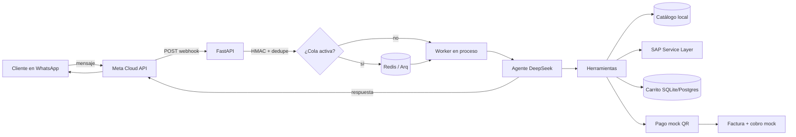
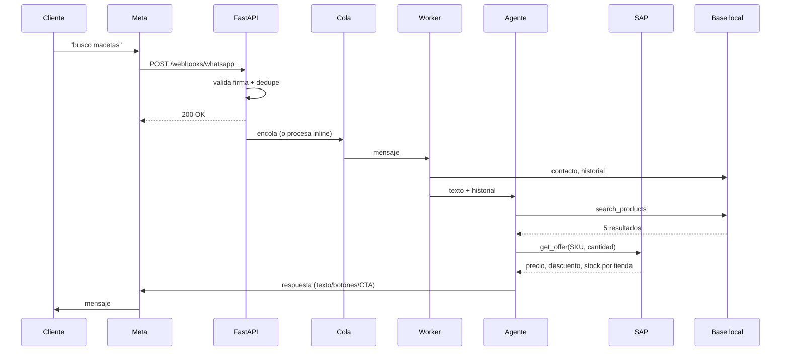
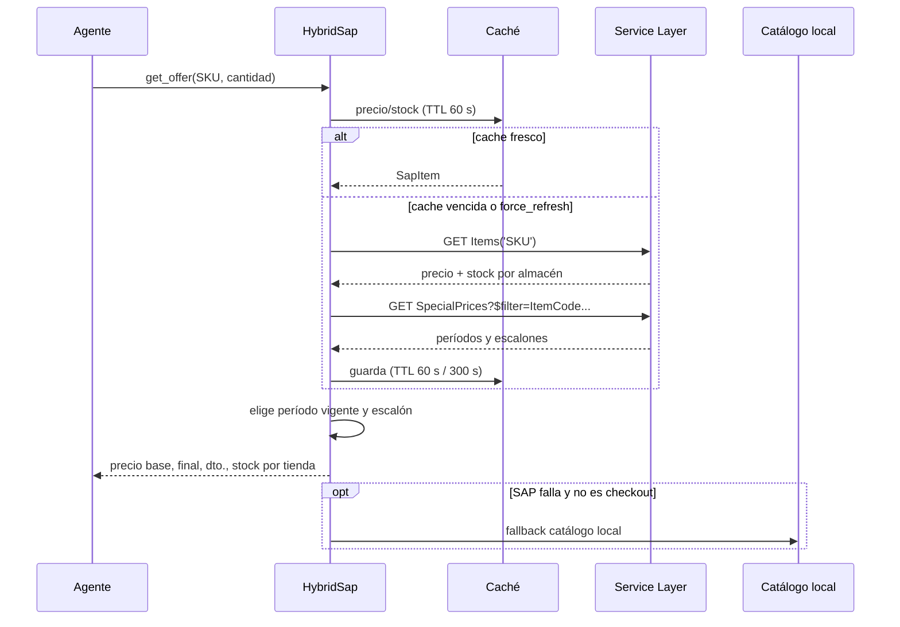
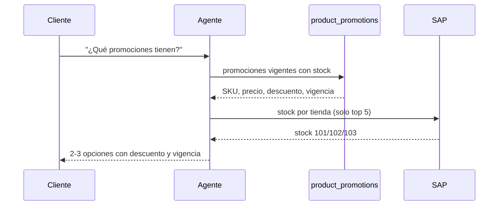
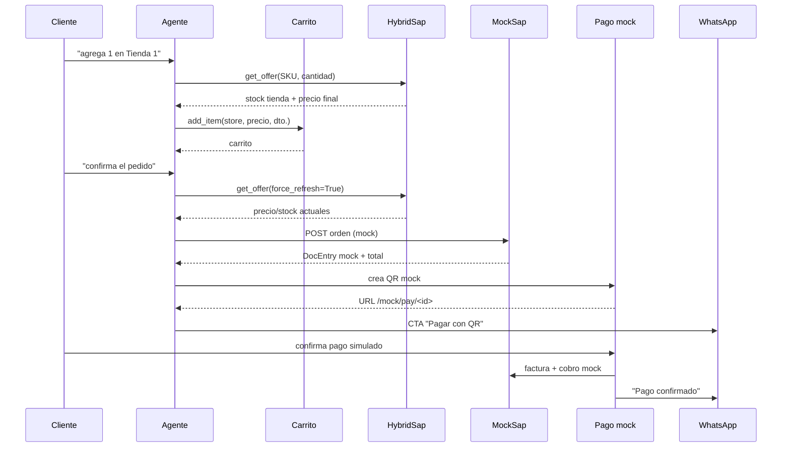
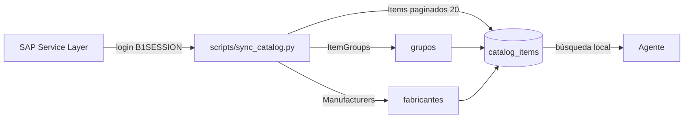
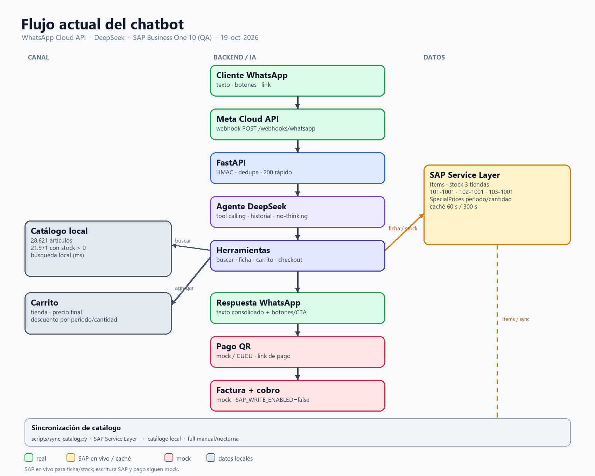

# Flujo actual de la aplicación

**Estado:** 19-oct-2026 · WhatsApp Cloud API + DeepSeek + SAP Business One 10 (QA)

---

## 1. Vista general



---

## 2. Secuencia de un mensaje



Detalles:

- El webhook valida `X-Hub-Signature-256` y deduplica por `message.id`.
- Responde `200` rápido; si `QUEUE_ENABLED=true`, el trabajo va a Redis/Arq.
- El agente usa DeepSeek en modo **no-thinking** para bajar latencia.
- El historial se guarda en `messages`; el contexto enviado al LLM son los últimos 10 mensajes.

---

## 3. Ficha de producto, precio y stock


Reglas:

- Tiendas: `101-1001` (Tienda 1), `102-1001` (Tienda 2), `103-1001` (Tienda 3).
- Stock: `InStock - Committed` por almacén.
- Precio: lista `SAP_PRICE_LIST` (1).
- Descuento: `SpecialPrices` → período vigente → escalón de cantidad.
- Caché de artículo: 60 s. Caché de precios especiales: 300 s.
- Checkout usa `force_refresh=True`: no acepta caché.

## 3.1 Listar promociones



`product_promotions` se llena con `scripts/sync_promotions.py` desde
`SpecialPrices`. Sin esa tabla el agente no puede saber qué productos tienen
descuento hasta que el cliente menciona un SKU.

---

## 4. Carrito y checkout



Estados: `pending_payment → paid → invoiced` (o `cancelled`).

---

## 5. Sincronización del catálogo



- Full sync manual/nocturna; hoy hay **28.621 artículos** y **21.971 con stock > 0**.
- Paginación por `ItemCode gt ...` (keyset) para evitar `$skip` profundo.
- La búsqueda del bot no consulta SAP; usa esta copia local.

---

## 6. Qué es real y qué es mock

| Pieza | Estado actual |
|---|---|
| WhatsApp Cloud API | **Real** (token permanente, webhook firmado) |
| DeepSeek | **Real** |
| Catálogo local | **Snapshot de SAP QA** (28.621) |
| Precio/stock por SKU | **SAP en vivo** con caché |
| Carrito | **Local** (SQLite/Postgres) |
| Pedido en SAP | **Mock** (`SAP_WRITE_ENABLED=false`) |
| Factura/cobro SAP | **Mock** |
| Pago | **Mock QR** |
| Stock/promociones | **SAP en vivo** al consultar ficha/agregar/checkout |

---

## 7. Fallos y degradación

| Situación | Comportamiento |
|---|---|
| SAP no responde en ficha | Usa caché; si no hay, catálogo local |
| SAP no responde en checkout | **Bloquea** el checkout (`force_refresh`) |
| Redis no disponible | El webhook procesa inline (fallback) |
| WhatsApp rechaza envío | Se registra y el mensaje entrante queda guardado |
| Pago no confirmado | Pedido queda `pending_payment`; job de reconciliación pendiente |
| LLM falla | Responde el agente demo o un mensaje de fallback |

---

## 8. Configuración actual (sin secretos)

```env
SAP_MODE=service_layer
SAP_LIVE_READS=true
SAP_WRITE_ENABLED=false
SAP_CACHE_TTL_SECONDS=60
SAP_PRICE_CACHE_TTL_SECONDS=300
SAP_PRICE_LIST=1
SAP_WAREHOUSE=101-1001
SAP_STORES=101-1001=Tienda 1,102-1001=Tienda 2,103-1001=Tienda 3
PAYMENT_PROVIDER=mock_qr
WA_DRY_RUN=false
QUEUE_ENABLED=false
```

---

## 9. Diagrama visual


